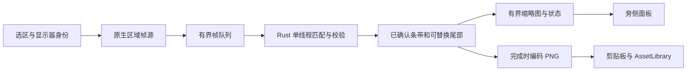

# ADR 0109: 微信式滚动长截图 / Scrolling capture

- Status: **Proposed — research only; not implemented or accepted**
- Date: 2026-10-15
- Source baseline: `2a60b840c4175f13a7864c43c5e2cd1065c8df22`
- Related: [#152](https://github.com/yuxino/Kiri/issues/152)

## 结论

推荐 **用户手动滚动 + 固定选区的原生连续帧 + Rust 垂直位移匹配 + 增量拼接**。
选区旁显示已经拼好的长图，完成后沿用 Kiri 的复制、素材库和完成卡片。
这是对 Kiri 当前架构最合适的候选方案；尚无本项目原型、性能数据或原生验收，
不能把研究结论写成已经实现的能力。

这里的“微信式”指框选、滚动、即时预览、完成的使用体验，不声称知道微信内部算法。
第一版聚焦单个显示器中的单个纵向滚动内容区；不承诺跨显示器、横向/二维拼接、
页面缩放、滚动过程中窗口移动、自动滚轮或无限长度。

## 为什么选这条路线

| 候选 | 适配 Kiri 的情况 | 决策 |
| --- | --- | --- |
| 固定区域帧流 + 手动滚动 + 垂直像素匹配 | 可覆盖浏览器、聊天、设置和文档窗口；已有三平台帧生产代码 | 主方案 |
| 模拟滚轮 + 等待 + 单次截图 | 需要处理权限、焦点、嵌套滚动区和惯性；滚轮数值不等于实际内容位移 | 后续可独立增加闭环自动滚动，不作为首版前提 |
| 浏览器 DOM/CDP 全页截图 | 网页专用；无法覆盖桌面程序，且另有浏览器连接和权限边界 | 不作通用实现 |
| OCR 后重排内容 | 丢失原图排版和图片，也无法保证文字不漏 | 不用于拼接 |
| 特征点 + 全景 homography/融合 | 截屏通常只需平移；变形、缩放或羽化会损伤文字 | 不用于最终合成 |
| OpenCV/平台视觉库 | 可作后续困难场景的位移候选生成器；需额外依赖、包体和平台一致性验证 | 先实现窄范围纯 Rust 算法，再用失败样本决定是否引入 |

参考的直接证据：

- [ShareX 官方说明](https://getsharex.com/docs/scrolling-screenshot)描述比较相邻截图并追加新内容，
  同时指出固定边栏、动画和 hover 会干扰匹配。Kiri 应明确拒绝不可信接缝，不能把
  “最佳猜测”显示成无损成功。
- [Snapzy 的滚动截图设计](https://github.com/duongductrong/Snapzy/blob/master/docs/SCROLLING_CAPTURE.md)
  提供帧流、串行拼接、旁侧预览和完成前收尾的实现参考。其滚轮监控、自动滚动权限与
  捕获中忽略 Esc 的交互不能直接移植到 Kiri。
- [eSearch](https://github.com/xushengfeng/eSearch)提供跨平台滚动截屏的产品参考。
  本提案未移植第三方代码；如后续复用，须核对具体文件许可，不能把参考项目当作 MIT 源码库。
- [ScreenCast Portal 协议](https://flatpak.github.io/xdg-desktop-portal/docs/doc-org.freedesktop.portal.ScreenCast.html)
  定义了会话、用户授权和 PipeWire 流。Wayland 持续采集应走该路径，不能反复调用
  Screenshot Portal，也不能假设旧授权一定免除新的源选择。

以上是设计参考，不是同硬件横评或性能排名；外部链接按研究当日内容核对。

## 用户流程与窗口

1. 沿用当前截图入口，点击窗口或拖出选区。在标注工具栏新增“长截图”。
   有未保存标注时不得静默丢弃：首版禁用长截图并提示先完成当前截图或重新选区。
2. 开始前允许调整选区，提示尽量只框滚动内容，避开固定边栏和播放中的视频。
   启动时锁定显示器身份、物理像素矩形、缩放和色彩格式，之后不跟随鼠标换屏。
3. 准备原生流，隐藏冻结遮罩并确认隐藏生效，恢复原应用焦点。
   **首个合格的实时帧**才是拼接基线；冻结 PNG 只用于选区，不与另一条采集链路混拼。
   按采集时间戳和启动代次丢弃隐藏确认前的排队帧，避免把尚含遮罩的旧帧误作基线。
4. 用户用滚轮或触控板向下滚动。一个非交互细边框标出选区；旁侧小面板显示已接收预览、
   图片尺寸、“完成”和“取消”。区域内输入交给原应用，面板初次出现不抢焦点。
   当前活动画面与已拼接预览要有区别，不能把未通过校验的内容显示成已经保存。
5. 匹配失败时停止追加，保留结果，提示“滚动过快，请稍向上滚回已截取内容”。
   允许回到已知尾部后接续；完成按钮始终可达。没有可验证重叠时不能靠猜测补齐。
6. “完成”等待正在处理的帧，做一次有截止时间的末帧稳定与匹配检查，再停止采集。
   若最后一段无法验证，明确提供“继续调整”或“保存已截取部分”；不得悄悄截断后报成功。
   用户确认完整结果后复制并保存，恢复原应用，不自动打开素材库或编辑器。

布局优先右侧，其次左侧、上/下；用真实面板尺寸和显示器 work area 计算。
窄屏可隐藏缩略图，只留完成/取消。只有经过当前采集后端验证的窗口排除，才允许控件
覆盖选区。Linux 无可靠排除时，边框也必须完全位于选区外，不能用居中描边侵入像素。
若选区外没有可验证的控件位置，首版要求缩小选区，不在选区内显示会被截入的工具栏。
Wayland 窗口位置由合成器控制；若不能确认安全位置，该会话不开放滚动截图。

### 键盘是单独的验收门槛

现有 overlay 的 `keydown` 在隐藏后不能接收原应用中的 Esc/Enter；录屏面板的按键也
只在聚焦时有效。不能用前端监听测试冒充全局按键实现。

首版实现须先验证 macOS/Windows/X11 的临时原生取消快捷键能否在不增加输入监听权限、
不替换用户现有绑定的前提下可靠注册。所有结束、启动失败和窗口销毁路径都要解除注册。
面板聚焦时保留 Esc 取消、Enter 完成；原应用聚焦时不假设裸 Enter 可用，也不吞掉其
文本输入。临时 Esc 无法成立的平台应保持功能未开放，或先通过独立产品决策明确
按钮/托盘降级与提示，不能偷偷削弱现有 Escape 取消契约。
Wayland 不假定支持任意全局按键，也不自动安装桌面绑定。

## Kiri 源码接入点

| 现有位置 | 已核实能力或约束 | 建议改动 |
| --- | --- | --- |
| `src/windows/OverlayWindow.tsx` | 冻结图负责选择、标注并占有输入 | 只增加入口和选区交接，不把帧拼接放入 React |
| `src-tauri/src/capture/macos.rs` | `MacRecordingSession` 生产 BGRA；SCK 过滤器经主线程创建，可排除本进程窗口 | 抽出精确像素、可配置帧率的帧源；不创建编码器或音频 |
| `src-tauri/src/capture/windows.rs` | WGC 帧生产、完整 `DisplayIdentity` 验证、行跨度处理 | 抽出帧源；尺寸改变须拒绝，不能沿用越界补零作为有效截图 |
| `src-tauri/src/capture/linux.rs`、`linux_media.rs` | X11 原生采集路径和 Wayland ScreenCast/PipeWire，具有启动/失败处理 | 保留两条路径；Wayland 重新确认同一显示器，拒绝模糊映射 |
| `src-tauri/src/capture/mod.rs` | 容量 2 的 `SyncSender<Vec<u8>>`，缺少帧身份/时间 | 新增有元数据的帧类型；不要让新需求扰动现有录屏时钟 |
| `src-tauri/src/core/policy.rs` | 录屏尺寸取偶数以满足编码器 | 长截图采用精确像素裁切，奇数宽高不得被裁掉或拉伸 |
| `src-tauri/src/core/recording_controls.rs`、`platform/*` | 已有选区旁布局、焦点/窗口辅助方法 | 复用几何规则，分别验证排除；不能复制录屏面板的 `set_focus()` |
| `src-tauri/src/commands.rs` | 普通截图验 PNG、owner token、复制、库保存与关闭后完成通知 | 新增长截图专用 finish；保留普通截图的显示器尺寸校验 |
| `src-tauri/src/state.rs`、`lib.rs`、`protocol.rs` | 单次捕获、窗口生命周期、本地内存资源 | 增加独立会话状态、销毁清理和有界预览 URL |
| `src/lib/ipc.ts`、`src/main.tsx`、`src-tauri/capabilities/default.json` | 类型化 IPC、按窗口懒加载、窗口权限表 | 增加专用面板和窄命令权限，不开放通用截图/文件写入接口 |

建议新增 `capture/frame_source.rs`、`core/scroll_stitch.rs`、`scroll_capture.rs`、
`scroll_capture_commands.rs` 和 `windows/ScrollCaptureWindow.tsx`。这些是候选文件名，
本 PR 没有创建对应运行时代码。尽量提取现有帧源，不把 MP4 录制启动流程伪装成长截图。

帧结构至少带 `session_id`、单调 `sequence`/`captured_at`、`display_revision`、
`width/height/stride`、像素格式和 bytes。原生回调只提交有界帧，不等编码或拼接。
队列丢帧要可观察：慢消费者不能无限积压，也不能假设相邻处理帧仍有重叠。
候选命令为 `start(selection)`、`finish(session_id)`、`cancel(session_id)` 和读状态；
由后端验证调用窗口、会话代次和一次性完成，不允许别的窗口操作会话。

## 拼接算法

### 匹配与提交分开

目标是找整数纵向位移 `d`，使旧帧的 `old[y + d, x]` 与新帧的 `new[y, x]` 在
有效重叠区一致。没有固定边缘时，`d > 0` 表示向下滚动，输出只追加新帧底部 `d` 行。
最终合成使用原始像素，不做透视变换、插值、渐变融合或 OCR 重画。

1. 验证身份、尺寸、stride、格式和序号；拒绝乱序、断开的源和几何变化。
2. 对缩小后的亮度/梯度做多列行签名，提出多个候选位移；不能只取一个最小均方误差。
3. 在原尺寸整数坐标附近精搜，跨不同横向区块和多个纵向位置验证，优先有纹理的像素。
   保留最优/次优差距、有效纹理量、重叠高度、局部一致性和水平位移诊断。
4. 只有证据充分且唯一的位移才提交。小块动画可不参与定位，但最终输出仍保留真实像素；
   若它挡住接缝或变化占比太大，等待或暂停，不能修补出没有采集过的画面。
5. 已确认条带追加后立即释放旧整帧，只保留匹配锚点、必要的尾部和有限历史描述。
   预览从同一条带序列生成，不另起一个可能与导出不同的合成器。

采样率、最低重叠量、分数阈值和纹理阈值须从确定性 fixture 与原生样本校准。
原型可比较 15/30 fps；这些是实验档位，不是已达成的性能指标。
持续滚动时逐帧跟踪，只把通过清晰度和一致性检查的帧提交；若等到用户彻底停下才开始
定位，中间可能已经失去全部重叠。

### 必须明确处理的场景

| 场景 | 行为 |
| --- | --- |
| 静止或底部没有变化 | 不追加；“暂时没有新内容”不等于确定到底，不自动结束手动模式 |
| 一次跨过所有重叠 | 暂停并提示回滚；无法从两张不相交截图恢复缺失内容 |
| 完全相同的重复列表、大片纯白 | 多个偏移都可能正确；证据不足即拒绝，不能靠上次速度或滚轮数值消除歧义 |
| 向上滚回 | 只重新定位，不向结果追加重复内容；超过有限历史时提示回到尾部或重新开始 |
| 固定顶栏/底栏/侧栏 | 区分固定层与移动层；先排除侧栏对行判定的干扰，再估计上下边界，不能从一对相似帧推断 |
| 内容懒加载、滚动条跳转、窗口移动/缩放 | 重新验证几何和重叠；重排无法用单一平移解释时停止追加 |
| 惯性、回弹、分数像素渲染 | 跟踪变化并等候可验证帧；不把回弹当新内容，不把亚像素误差累计进输出 |
| 大幅动画、hover、半透明渐隐条 | 降低有效样本权重并检查接缝；无法验证则停，隐藏鼠标不等于消除 hover |

固定边缘分两步交付。首版可靠基线是由用户选择连续滚动内容区，并对检测到的固定边缘
给出重新选区建议。自动保留“首帧顶栏一次、末帧底栏一次”需要额外的分层模型、候选期
缓存和边界冻结规则；在其像素回归通过前不能默默裁边或宣称支持任意整窗。
底部尚未离开渐隐/遮挡区域的内容保留为可替换尾部；若最终仍被遮挡，不声称恢复了原文。

## 会话、资源与保存

状态建议为 `preparing → capturing ↔ needs-overlap → finishing → saving → completed`；
`cancelled`、`failed` 是终态。显示器丢失、权限撤回或源关闭停止采集，但在可行时保留
已确认结果供用户明确保存。不得自动重新授权、换屏或换源继续拼。

- 通过后端独占 lease 与普通截图/录屏互斥；终止后等待 worker 清理再允许新会话。
  旧代次的帧、定时器和完成回调不能影响下一次捕获。完成与取消只有一个获胜者。
- 取消停止原生流、撤销快捷键、销毁辅助窗口、清除临时像素，并恢复原应用焦点。
  不生成素材；若已经跨过不可撤销的保存提交点，UI 应显示保存中而不是假装取消成功。
- 原生窗创建遵循 Windows 现有串行窗口 worker；不要在同步 IPC 回调中创建/销毁其
  owner WebView。返回完成响应后由 owner 关闭，再展示完成通知。
- 内存按字节预算而非单纯帧数限制。需要分别计入原生缓冲、队列、匹配副本、条带、
  PNG 编码、剪贴板解码和 WebView 预览。达到高度、面积、内存或时长上限时停止追加，
  明确提示保存已有部分；不能悄悄缩小原图。
- 原型先使用内存条带和硬上限，避免每次追加重新分配整张图。长会话磁盘 spool 如需
  引入，须定义私有临时目录、配额、取消/崩溃清理和隐私文档，不能默认落盘所有帧。
- 全图留在 Rust；React 只读缩略图和状态。预览通过 owner/session 绑定的本地协议读取，
  代次结束即失效，不在事件里广播整图或反复传 base64。
- 完成时后端生成 PNG，单独验证宽高/面积预算，再复用 `AssetLibrary` 和剪贴板语义。
  **不放宽 `confirm_capture` 对前端 PNG 的显示器尺寸限制**，也不接收前端任意长图作为
  本次原生拼接结果。保存失败保留可重试结果，复制失败保留已保存素材并明确提示。

### 输出上限必须贯穿打开、编辑和复制

`media_import.rs` 的外部图片导入当前限制每边 8192；`core/annotation.rs` 的文档维度上限
为 65536。这两个数都不能当作 WebKit/WebView2 的 Canvas、原生解码器或剪贴板安全上限。
后端直接入库能绕开外部导入，却不能解决重开编辑器、另存后重新导入和多副本内存峰值。
首版上限必须取采集、存储、缩略图、查看、编辑、复制的实测可用交集；若提供超出完整
编辑能力的导出模式，应先独立定义产品行为，不能产出默认完成卡片无法正常处理的图片。
本研究不预先承诺 32768/65536 高度或“无限长”，也不为长截图整体放松导入/编辑安全校验。
还须覆盖“复制 → Kiri 粘贴图片”的往返：`platform/mod.rs`、`platform/linux.rs` 的
剪贴板读取限制每边 8192、解码数据 128 MiB；外部导入另有限制 32 MiB 编码数据和
128 MiB 解码预算。原生复制成功不代表重新粘贴成功。二维码路径还有 3200 万像素限制，
超限时应准确说明，不把全部后续操作笼统标为可用。

## 平台交付顺序

| 平台 | 接入路线 | 开放前条件 |
| --- | --- | --- |
| macOS | ScreenCaptureKit，固定显示器与区域，排除 Kiri 本进程 | 主线程过滤器、奇数像素、稳定签名/TCC、全屏 Space、触控板和取消键实测 |
| Windows | WGC，固定 `DisplayIdentity`，BGRA 归一化 | 检查窗口排除结果而非忽略 API 错误；DPI/显示变化拒绝；NSIS/portable 实包验证 |
| Linux X11 | 现有 `ximagesrc` 路径提取帧生产，关闭鼠标绘制 | 控件/描边完全在选区外，真实焦点/按键、安装包与 X11 fixture 验证 |
| Linux Wayland | ScreenCast + PipeWire，保留单屏限制 | 授权、同源映射、可验证的控件位置、可达取消；条件不满足时明确不可用 |

优先并行实现共享核心、macOS/Windows 适配与 UI；X11 接续同一核心。
Wayland 可并行做技术验证，但不让一个未经验证的能力布尔值冒充全平台支持。

## 验证与实施拆分

1. **共享核心**：独立于窗口和系统权限的 Rust stitcher。生成带唯一行号/像素编码的长图，
   裁出已知偏移的 viewport 序列，导出结果逐像素比较，要求无漏行、重行或宽度改变。
   覆盖奇数尺寸、1×/1.25×/1.5×/2×、小步/大步、重复/乱序/丢帧、反向滚动、重复行、
   纯色、水平移动、重排、动画、固定头尾和达到边界。无法确定的输入必须得到拒绝状态。
2. **帧源与生命周期**：注入队列验证背压、取消/完成竞争、源失败、迟到帧、窗口销毁、
   显示器变化和单次保存。帧源提取必须保留现有录屏测试，尤其尺寸和时间行为。
3. **真实桌面 harness**：外部测试页面显示公开生成内容并真实滚动，由真实 Kiri 截取；
   测试输入可以合成，正式 Kiri 内不加模拟桌面开关。检查 PNG/剪贴板像素、辅助窗口
   未入图、原应用仍能滚动、所有按钮可达、素材只保存一次、取消无素材。
4. **接缝与性能**：记录每段预期/实测位移、拒绝原因、输出尺寸、处理耗时分位数、
   帧丢弃数、内存峰值和最后一帧是否提交。覆盖高 DPI 文本、长聊天、PDF、表格、懒加载、
   底部回弹、源中断和超限。指标只记录数值，不记录用户截图或 OCR 内容。
5. **原生验收**：复用 Linux 安装 `.deb` 后的 X11 harness 和 Windows NSIS/portable
   harness；macOS 用固定路径稳定签名包实测。普通 PR 绿灯和 `ci:linux-package` 仅
   打包不能代替桌面验收；按 [CI 分层](../qa/ci-tiers.md)显式请求 `linux/windows/full`。
   Wayland 四档缩放、实体混合 DPI、热插拔、真实输入法/触控板另列通过或待验。
6. **最终交付**：七种语言键/占位符一致，补充使用指南和真实支持范围，再更新产品概览。
   固定边缘自动处理、超长图片和自动滚动分别以失败 fixture 和实机证据推进。

研究 PR 只记录推荐设计和未决门槛。源码编译或现有测试通过，均不代表滚动截图已经实现。
待算法原型、全链路图片尺寸、辅助窗口排除与取消路径得到验证后，才适合批准实现范围。

## English summary

Propose manual vertical scrolling over a fixed native region stream, with a
Rust translation matcher, conservative overlap validation, bounded strip
storage, and a preview of committed pixels. Reuse frame producers, not video
encoding. Preserve original pixels and refuse ambiguous seams. Keep completion
local and clipboard-first through the existing library boundary.

This research-only proposal does not implement scrolling capture. Global
cancellation after focus returns to the source app, helper-window exclusion,
sticky layers, and end-to-end long-image size limits are explicit acceptance
gates. Wayland requires its own ScreenCast authorization and placement checks.
No claim is made about WeChat internals, achieved performance, native acceptance,
or unrestricted image length. Keep the research PR in draft; do not merge or
close the feature request on the strength of this document.
