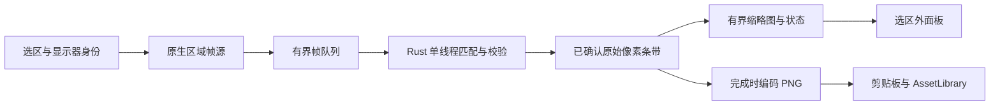

# ADR 0109: 微信式滚动长截图 / Scrolling capture

- Status: **Implemented candidate — native acceptance pending; not merged**
- Date: 2026-10-15
- Research source baseline: `2a60b840c4175f13a7864c43c5e2cd1065c8df22`
- Related: [#152](https://github.com/yuxino/Kiri/issues/152)

## 结论与实现范围

采用 **用户手动滚动 + 固定选区的原生连续帧 + Rust 垂直位移匹配 + 增量拼接**。
截图工具栏入口、原生帧源、Rust 拼接、旁侧预览、取消与复制入库已有运行时代码。
本记录由研究提案更新为实现候选，保留路线选择与后续验收要求；代码存在不等于
已完成三平台实机验收，也不构成性能结论。

这里的“微信式”指框选、滚动、即时预览、完成的使用体验，不声称知道微信内部算法。
首版只处理同一显示器内、固定选区中的纵向滚动内容；不提供自动滚轮、横向或二维
拼接、自动移除固定栏、滚动中移动或缩放窗口，以及无限长度。

## 为什么选这条路线

| 候选 | 适配 Kiri 的情况 | 决策 |
| --- | --- | --- |
| 固定区域帧流 + 手动滚动 + 垂直像素匹配 | 可覆盖浏览器、聊天、设置和文档窗口；已有三平台帧生产代码 | 主方案 |
| 模拟滚轮 + 等待 + 单次截图 | 需要处理权限、焦点、嵌套滚动区和惯性；滚轮数值不等于实际内容位移 | 后续可独立增加闭环自动滚动，不作为首版前提 |
| 浏览器 DOM/CDP 全页截图 | 网页专用；无法覆盖桌面程序，且另有浏览器连接和权限边界 | 不作通用实现 |
| OCR 后重排内容 | 丢失原图排版和图片，也无法保证文字不漏 | 不用于拼接 |
| 特征点 + 全景 homography/融合 | 截屏通常只需平移；变形、缩放或羽化会损伤文字 | 不用于最终合成 |
| OpenCV/平台视觉库 | 可作后续困难场景的位移候选生成器；需额外依赖、包体和平台一致性验证 | 先实现窄范围纯 Rust 算法，再用失败样本决定是否引入 |

参考的直接证据：

- [ShareX 官方说明](https://getsharex.com/docs/scrolling-screenshot)描述比较相邻截图并追加新内容，
  同时指出固定边栏、动画和 hover 会干扰匹配。Kiri 应明确拒绝不可信接缝，不能把
  “最佳猜测”显示成无损成功。
- [Snapzy 的滚动截图设计](https://github.com/duongductrong/Snapzy/blob/master/docs/SCROLLING_CAPTURE.md)
  提供帧流、串行拼接、旁侧预览和完成前收尾的实现参考。其滚轮监控、自动滚动权限与
  捕获中忽略 Esc 的交互不能直接移植到 Kiri。
- [eSearch](https://github.com/xushengfeng/eSearch)提供跨平台滚动截屏的产品参考。
  本提案未移植第三方代码；如后续复用，须核对具体文件许可，不能把参考项目当作 MIT 源码库。
- [ScreenCast Portal 协议](https://flatpak.github.io/xdg-desktop-portal/docs/doc-org.freedesktop.portal.ScreenCast.html)
  定义了会话、用户授权和 PipeWire 流。Wayland 持续采集应走该路径，不能反复调用
  Screenshot Portal，也不能假设旧授权一定免除新的源选择。

以上是设计参考，不是同硬件横评或性能排名；外部链接按研究当日内容核对。

## 用户流程与窗口

1. 打开截图，点击窗口或拖出选区，再点击工具栏“长截图”。已有标注时禁用该入口，
   先完成当前截图或重新选区，不静默丢弃标注。
2. 开始前可调整选区。只框纵向滚动内容，避开固定顶栏、底栏、侧栏和播放中的视频。
   会话固定该显示器、缩放和物理像素矩形，不跟随鼠标换屏。
3. 创建辅助面板、隐藏冻结遮罩、恢复原应用焦点，再启动原生流。
   **首个实时帧**是拼接基线；冻结 PNG 只用于选区，不与实时流混拼。
4. 用户用滚轮或触控板缓慢向下滚动。旁侧面板显示已接收预览、图片尺寸、“完成”
   和“取消”。原应用仍可接收滚动，面板初次出现不抢焦点。预览只显示已经通过校验
   的内容，不把当前尚未匹配的 viewport 显示成已保存。
5. 匹配失败时停止追加并保留结果，提示稍向上滚回已截取内容。重新找到已有内容后
   可继续向下接续；无可靠重叠时不会猜测接缝。
6. “完成”执行有截止时间的末帧检查，再编码 PNG。最后一段无法验证或达到尺寸上限
   时，须选择“继续调整”或明确“保存已截取部分”，不会悄悄截断后报成功。
   完成沿用本地剪贴板、素材库和完成卡片，不自动打开素材库或编辑器。

面板按显示器 work area 定位，优先右侧，其次左侧、上/下；优先使用 272×500、
最小 240×260 的逻辑尺寸。所有平台均要求面板完全在选区外，不依赖窗口排除来允许
覆盖选区；没有安全位置时拒绝启动并提示缩小选区。首版没有额外的选区描边窗口。

### 键盘

隐藏 overlay 的前端 `keydown` 无法接收原应用中的按键。实现为活动会话临时注册
原生裸 Esc，成功、取消、启动失败及窗口销毁时解除注册；注册失败则拒绝启动。
不修改用户捕获快捷键，也不新增输入监听权限。

Esc 从原应用取消活动会话；面板聚焦时 Enter 完成。原应用聚焦时 Enter 保持其原有
行为。会话期间再次按已配置的捕获快捷键会聚焦长截图面板，随后可用 Enter 完成。
各平台真实焦点和全局取消仍属于原生验收范围，前端按键测试不能替代。

X11 面板在首次映射前设置 `override_redirect`，避免被活动全屏窗口压住；不抢占输入，
也不在首次显示时聚焦。用户明确按捕获快捷键后，才对本进程拥有的面板 XID 请求输入
焦点并聚焦 WebView。启动时保留原应用的精确窗口目标，完成或取消时仍能恢复焦点。

## 源码与数据边界

| 位置 | 实现职责 |
| --- | --- |
| `src/windows/OverlayWindow.tsx` | 未标注选区的入口和交接 |
| `src-tauri/src/capture/scroll.rs` | 固定显示器与精确物理像素区域；保留奇数宽高 |
| `src-tauri/src/capture/{macos,windows,linux}.rs`、`linux_media.rs` | SCK、WGC、X11 `ximagesrc` 原生无音频帧源，不创建视频编码器 |
| `src-tauri/src/core/scroll_stitch.rs` | 整数位移验证、原始像素条带、反向定位、拒绝歧义与输出上限 |
| `src-tauri/src/scroll_capture.rs` | 独占会话、辅助窗口、临时 Esc、worker、预览、完成和取消 |
| `src-tauri/src/commands.rs` | 专用原生结果入库与复制，不放宽普通截图的前端 PNG 校验 |
| `src-tauri/src/state.rs`、`lib.rs` | 捕获互斥、命令注册、快捷键和窗口销毁清理 |
| `src/windows/ScrollCaptureWindow.tsx`、`src/lib/ipc.ts`、`src/main.tsx` | 按窗口懒加载、类型化 IPC、预览与部分保存确认 |

长截图使用独立的两帧 BGRA 缓冲，保留最早待处理的重叠帧和最新视口；缓冲满时替换
后一帧，避免最后一次滚动被丢弃。录屏保留原有队列和背压规则。每个 worker 绑定独立
会话和固定尺寸，帧生产不等待 PNG 编码或 React；消费者不能假设收到的帧一定有重叠。
预览固定最多 248 像素宽，按长图比例生成、最高 8192 像素，避免先压短再拉宽。
有界 PNG 缩略图以 data URL 随串行轮询的 IPC 状态返回，React 不接收完整长图。状态、完成和取消命令
验证面板 owner 与会话 ID；其他窗口不能操作该会话。

原生桌面帧按已合成的、不透明 BGRA/BGRX 处理，输入中的未使用 alpha 字节归一化为
255，避免 RGB 数据正确但 PNG 和预览完全透明。直接 RGBA 测试输入仍保留原 alpha。

原研究提出逐帧显式携带 sequence、时间戳和显示器 revision，以及可观察的丢帧计数。
这些不应被误读为现有 BGRA 通道已经具备的元数据；后续扩展须保留录屏时钟语义。

## 拼接算法

目标是找唯一的整数纵向位置，使新帧与已确认原始像素的重叠一致。最终合成使用
采集的原始像素，不做透视变换、插值、渐变融合或 OCR 重画。

1. 验证固定宽高、BGRA buffer 与行跨度；源启动时验证显示器和裁切几何。
2. 对有纹理的多列行签名生成多个候选位置，舍弃过度重复的签名，不只取最小误差。
3. 在原始像素上按横向区块验证候选的重叠；容忍微小渲染差异，但局部显著内容差异
   直接拒绝，不能被大片相同背景平均掉。多个位置都能通过时拒绝追加。
4. 只有唯一可靠位置延伸到现有尾部之后时才追加新条带。反向滚动只重新定位，
   不追加重复内容。无法匹配的帧不移动已确认锚点。
5. 输出和预览从同一条带序列生成，保留真实宽度和奇数尺寸，不重采样文字。

| 场景 | 首版行为 |
| --- | --- |
| 静止或底部没有变化 | 不追加，不自动宣称到底或结束 |
| 一次跨过全部重叠 | 保留已有结果，提示回滚到可重叠位置 |
| 重复列表、大片纯色、水平偏移或内容重排 | 无唯一证据时拒绝，不能靠滚轮数值或速度猜测 |
| 向上滚回已有内容 | 重新定位，回到尾部后可继续；不追加重复行 |
| 固定顶栏、底栏或侧栏 | 不自动移除；先选取纯滚动内容区，无法匹配时调整选区 |
| 动画、hover、回弹、亚像素渲染变化 | 只有原始像素验证通过才追加；不承诺任意动态内容都可接续 |
| 输出达到上限 | 保留最后一次完整提交的结果，要求明确保存已有部分 |

原研究的自动分离固定层、保留首帧顶栏一次与末帧底栏一次、可替换遮挡尾部等方案
属于后续设计；首版未实现，也不声称支持任意整窗。采样率与匹配阈值仍须用原生样本
校准，不把配置值写成已达成的性能指标。

## 会话、资源与保存

状态包含 `starting`、`capturing`、`needsOverlap`、`finishing`、`saving` 和 `failed`。
会话与普通捕获/录屏互斥，后台 worker 串行处理帧；结束时清理帧源、临时快捷键、
面板与像素资源。取消不生成素材；进入最终库保存后按保存语义处理，不能假装撤销
已完成的写入。旧会话回调不得影响下一次捕获。

完成通过专用原生提交路径保存 PNG，不接收前端任意长图，也不放宽 `confirm_capture`
对普通截图的显示器尺寸限制。复制失败保留已保存素材并提示；保存失败保留可重试
结果。Windows 辅助窗口沿用串行窗口 worker，异步 IPC 不同步阻塞原生窗口创建。

首版输出硬上限是 **每边 8192 像素、总面积 32 MiPixels（33,554,432 像素）**，
不会缩小原图以绕过上限。条带保存在内存，没有把完整采样帧序列落盘的 spool。
这些上限与现有导入、复制和编辑边界对齐，不能代替真实解码、剪贴板往返及内存
峰值验收。二维码自己的 3200 万像素限制仍独立存在，不因长截图放宽。

## 平台边界与待验项目

| 平台 | 候选实现 | 原生验收要求 |
| --- | --- | --- |
| macOS | ScreenCaptureKit，固定显示器与精确区域，无编码器或音频 | 稳定签名/TCC、主线程过滤器、奇数像素、全屏 Space、触控板、焦点与 Esc |
| Windows | WGC，固定 `DisplayIdentity`，BGRA 归一化 | DPI/显示变化、辅助窗口未入图、真实焦点与 Esc、NSIS/portable 实包 |
| Linux X11 | `ximagesrc`，固定区域并关闭鼠标绘制 | `.deb` 安装、真实滚动和像素、控件完全在选区外、焦点、完成与取消 |
| Linux Wayland | 当前禁用 | ScreenCast/PipeWire 同源授权、安全位置、可达取消均须独立验证后再开放 |

## 验证与后续工作

- 共享核心使用生成图片裁出的已知 viewport 序列做像素比较，覆盖奇数尺寸、混合
  步长、反向恢复、无重叠、重复/纯色、水平移动、固定栏、BGRA 行跨度与输出边界。
  核心测试不等于原生端到端验收。
- 生命周期还须验证启动失败、取消/完成竞争、源失败、迟到回调、窗口销毁、显示器
  变化和单次保存；复用帧源不得破坏录屏尺寸和时间行为。
- 真实桌面 harness 从正式 Kiri 入口截取外部测试窗口，比较 PNG 和剪贴板，检查辅助
  窗口未入图、原应用能滚动、完成只保存一次、取消无素材。正式应用没有合成桌面开关。
- 接缝与性能须记录已知/实测位移、拒绝原因、输出尺寸、耗时、丢帧和内存峰值；
  不记录用户截图或 OCR 内容。未经测量不得宣称帧率、性能排名或无限长度。
- macOS 使用固定路径稳定签名包，Windows 使用 NSIS/portable，Linux 安装 `.deb`
  后运行隔离 X11 harness。虚拟桌面不能代替实体混合 DPI、热插拔、真实触控板或
  GNOME Wayland 验收；依 [CI 分层](../qa/ci-tiers.md)区分编译、打包与桌面通过。
- 七种语言使用指南同步描述实际边界。自动滚动、固定栏分层、超长输出和 Wayland
  分别根据失败 fixture 与原生证据推进，不能靠放宽阈值宣称支持。

本实现候选保持 Draft，不合并；功能请求是否完成须根据实际验收证据另行判断。

## English summary

The candidate now implements manual vertical scrolling over a fixed native
region stream, conservative Rust integer-position matching, original-pixel
strips, a side preview, session-wide Escape cancellation, and explicit
clipboard/library completion. Rejected frames preserve the accepted result;
reverse scrolling can reconnect it. Unverified tails require explicit partial
saving. The helper stays outside the selection, and output is bounded to
8192 pixels per side and 32 MiPixels.

macOS uses ScreenCaptureKit, Windows uses WGC, and Linux X11 uses ximagesrc.
Wayland remains disabled. Automatic scrolling and sticky-layer removal are
future work. No claim is made about WeChat internals, achieved performance,
completed native acceptance, or unrestricted image length. Keep the PR in draft
and unmerged pending the reported verification and platform acceptance.
